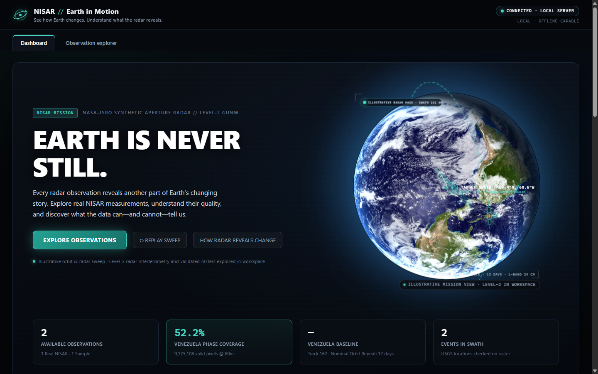
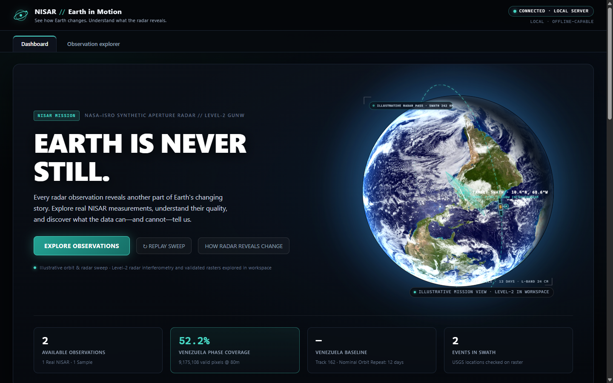
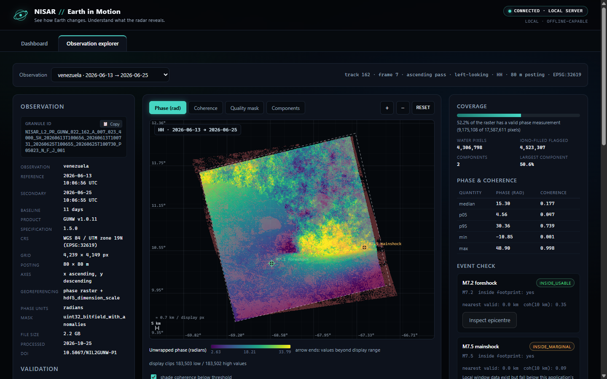
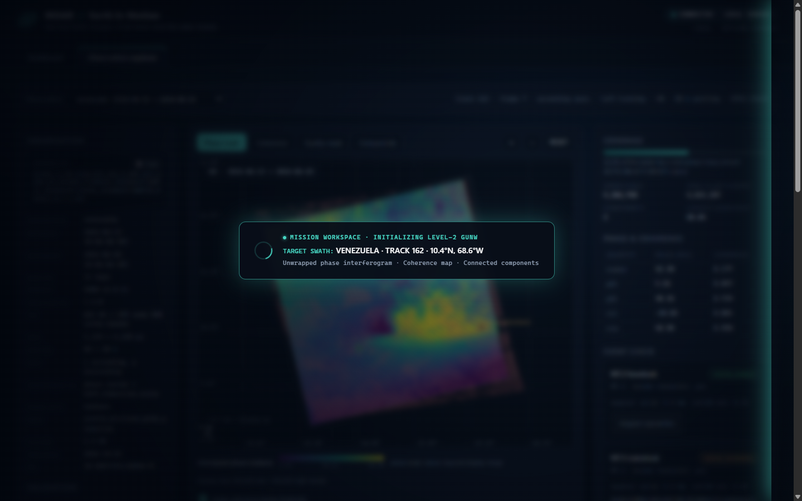
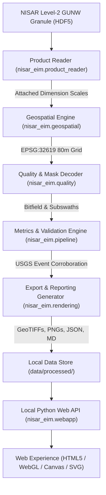

# NISAR // Earth in Motion

**Turning complex radar interferograms into honest, interpretable Earth-observation science.**

[](https://github.com/Aayushashsahu/LunaHorizon/actions/workflows/ci.yml)
[](LICENSE)
[](pyproject.toml)
[](https://www.spaceappschallenge.org/)
[](https://www.spaceappschallenge.org/)
[](README.md)

---

## Overview

**NISAR // Earth in Motion** is a local, offline-capable application that transforms **NASA–ISRO Synthetic Aperture Radar (NISAR)** Level-2 Geocoded UNWRapped Interferogram (GUNW) data into an interpretable, scientifically rigorous exploration experience.

Built for the **2026 NASA International Space Apps Challenge (*Dancing with the SARs*)**, this project was engineered entirely on a standard consumer laptop: CPU-only, ₹0 budget, no paid APIs, no external CDN dependencies, and 100% offline execution after product processing.

Instead of presenting superficial mockups or fabricating uncalibrated ground-displacement claims, the platform ingests authentic NISAR radar products, resolves deep geospatial indexing challenges from first principles, and pairs high-performance data processing with an aerospace-grade mission visualization interface.

> *Note: This is an independent open-source project created by student participants for the NASA Space Apps Challenge 2026. It is not an official NASA or ISRO product, and has not been endorsed or officially validated by NASA, ISRO, or USGS.*

---

## Visual Tour

### 1. Cinematic Earth Observation & Mission Orbit
The application opens with an illustrative 3D planetary reveal—Earth scales up smoothly from deep space as dual luminous tracking boundaries hug its silhouette, handing off to a continuous Gram–Schmidt orthonormal satellite orbit and an illustrative radar swath sweep.



### 2. Planetary Reveal Choreography
Two non-overlapping green orbital-tracking strokes sweep diagonally upward along opposite limbs of the globe, meeting symmetrically at the North apex before dissolving into the mission HUD.



### 3. Interactive Observation Explorer
Seamlessly transition from the global mission view into an interactive 80-meter resolution georeferenced raster canvas over Venezuela, complete with layer toggles, graticule, scale bar, and independent USGS earthquake epicentre overlays.



### 4. Holographic Radar Transition
Clicking **Explore Observations** initiates an illustrative radar scan wipe that connects the global satellite orbit directly to the localized scientific workspace.



---

## The Problem

Active microwave synthetic aperture radar (SAR) is one of humanity's most powerful remote-sensing tools: emitting its own L-band microwave pulses, NISAR pierces clouds, smoke, and darkness to measure millimeter-scale changes in Earth's crust, ice sheets, and ecosystems.

However, interpreting Level-2 NISAR interferometry presents steep barriers:

1. **Massive, Complex HDF5 Granules:** A single Level-2 GUNW granule exceeds 2.3 GB and contains multiple independent spatial grids at different postings (e.g., 20 m wrapped phase vs. 80 m unwrapped phase).
2. **The 4× Coordinate Mismatch Bug:** Standard tools that perform naive file-wide dataset searches often pull the 20 m wrapped coordinate vectors ($16596 \times 16956$) for the 80 m unwrapped raster ($4149 \times 4239$), causing catastrophic dimension errors.
3. **Misleading Visuals & False Causation:** Unwrapped interferometric phase is frequently mislabelled as "centimeters of ground sink", ignoring severe atmospheric delays, orbital errors, and temporal decorrelation.
4. **Heavy Cloud / CDN Dependencies:** Many Earth observation web tools rely on heavy tile servers, external basemaps, or high-end GPUs, rendering them inaccessible in bandwidth-constrained or offline research settings.

---

## Our Solution

**NISAR // Earth in Motion** solves these challenges by combining rigorous geospatial engineering with an accessible, lightweight web architecture:

* **Dimension-Scale Ingestion:** Directly reads attached HDF5 `DIMENSION_LIST` scales, eliminating the 4× coordinate mismatch and ensuring pixel-center mathematical alignment.
* **100% Offline-First Architecture:** Powered by Python's standard library HTTP server and vanilla HTML5 Canvas/WebGL—no Mapbox, no Leaflet, no React, and no CDN calls.
* **Multi-Layer Quality Inspection:** Provides instant toggling between **Unwrapped Phase (radians)**, **Coherence Magnitude (0–1)**, **Subswath/Water Masks**, and **Connected Phase Components**.
* **Live Interactive Thresholding:** A responsive coherence threshold slider dynamically recalculates valid surface coverage and median coherence statistics in real time.
* **Geospatial Pixel Inspector:** Hover or click anywhere on the raster to retrieve exact geodetic coordinates (WGS 84), UTM coordinates (EPSG:32619), unwrapped phase, and coherence.
* **Independent Event Corroboration:** Integrates USGS ComCat earthquake records with windowed coherence spatial statistics (0.16 km, 1.6 km, and 10 km radii).

---

## Key Features

### Earth Observation Experience
* **Cinematic Planetary Reveal:** Smooth 2.5-second ease-out scale-up ($0.38 \rightarrow 1.0$) with zero Cumulative Layout Shift.
* **Dual Silhouette Tracking Arcs:** Mathematically precise SVG arcs ($R = 272.5\text{ px}$, radial error $< 0.05\text{ px}$) that sweep opposite hemispheres without crossing.
* **Continuous Orthonormal Cruise:** 3D satellite flight governed by Gram–Schmidt orthonormal basis vectors ($\mathbf{u} \cdot \mathbf{v} = 0$, radius error $< 10^{-13}\text{ px}$) and realistic Earth occultation.
* **Illustrative Radar Pass Demonstration:** Visualizes radar pulse emissions and illuminated ground swaths across the rotating globe.
* **Accessibility First:** Full `@media (prefers-reduced-motion: reduce)` support instantly displays a calm, high-resolution static fallback image.

### Scientific Observation Explorer
* **Georeferenced Canvas Rendering:** Native resolution rendering with smooth mouse-wheel zooming, click-and-drag panning, and dynamic scale bar.
* **Four Core Data Layers:**
  * **Phase:** Unwrapped interferometric phase difference in radians ($-\pi$ to $+\pi$ cycle representation).
  * **Coherence:** Interferometric correlation magnitude (0.0 to 1.0), measuring signal quality.
  * **Mask:** Decoded 32-bit bitfield isolating valid data, water boundaries, subswaths, and ionospheric fill flags.
  * **Connected Components:** Unwrapping island labels revealing phase-unwrapping reliability.
* **Threshold Coverage Table:** Interactive tabular breakdown displaying valid pixel count and coverage percentage across coherence cutoffs from 0.0 to 0.8.
* **Data Export Suite:** One-click downloads for georeferenced GeoTIFFs (EPSG:32619), PNG quicklooks with embedded provenance footers, machine-readable JSON metadata, and comprehensive Markdown scientific reports.

---

## Scientific Honesty & Guardrails

This project strictly adheres to scientific integrity. Presentation polish never replaces physical validity:

1. **Phase is Displayed in Radians, NOT Displacement:**  
   Unwrapped phase represents the interferometric phase difference between satellite passes after ellipsoid and topographic flattening. Transforming phase to line-of-sight displacement ($d = \frac{\phi \lambda}{4\pi}$) requires authoritative satellite phase sign conventions, incidence angle lookup tables, atmospheric phase screen corrections, and ground-truth calibration. Because the product metadata does not fully publish these conventions for this granule, **phase is reported strictly in radians**.
2. **Coherence is a Quality Indicator:**  
   Coherence measures phase stability and signal similarity between the two radar acquisitions. It indicates measurement reliability—it is **never** a measurement of displacement.
3. **No Earthquake Causation Claims:**  
   While the June 2026 Venezuela earthquake epicentres fall inside the raster bounds, interferometric fringes can be caused by atmospheric water vapor variations, ionospheric turbulence, orbital geometry errors, and vegetation changes. Date bracketing alone does not prove causation; the interface labels the data as an **exploratory observation**.
4. **Transparent Badging:**  
   The UI validation badge for `scientific_interpretation_validated` is openly displayed as **"not validated"**.
5. **Illustrative Visualizations:**  
   The rotating Earth, orbit track, and radar sweeps in the hero section are clearly labeled as illustrative concept demonstrations, not live spacecraft telemetry.

*For an exhaustive technical breakdown of these principles, see [docs/SCIENTIFIC_METHOD.md](docs/SCIENTIFIC_METHOD.md).*

---

## Case Study: Venezuela Earthquake Sequence (June 2026)

The application bundles and processes an authentic NISAR Level-2 GUNW interferogram capturing Northern Venezuela during the June 2026 seismic sequence:

```text
Granule: NISAR_L2_PR_GUNW_022_162_A_007_023_4000_SH_20260613T100656_20260613T100731_20260625T100655_20260625T100730_P05023_N_F_J_001.h5
Product: Level-2 Geocoded UNWRapped Interferogram (GUNW) · Version 1.0.11 · Spec 1.5.0
Pass: Track 162 · Frame 7 · Ascending Pass · Polarization: HH · Frequency: A
Temporal Baseline: 2026-06-13 10:06:56 UTC -> 2026-06-25 10:06:55 UTC (12 days / 1 nominal repeat cycle)
Coordinate System: WGS 84 / UTM zone 19N (EPSG:32619) · Regular 80 m x 80 m grid (4149 x 4239 pixels)
Valid Coverage: 9,175,108 of 17,587,611 pixels (52.2%) · Median Coherence: 0.177 (valid pixels)
```

### USGS Earthquake Verification (Doublet Sequence)
Independent event records from the USGS Comprehensive Earthquake Catalog (ComCat) are checked against the raster footprint:
* **M7.2 Foreshock (`us6000t7zc`):** 2026-06-24 22:04:31 UTC · $10.3713^\circ\text{N}, 68.5564^\circ\text{W}$ · Depth: 10.0 km.  
  *Status:* **Inside Usable Footprint** (0.0 km to nearest valid pixel). Nearest pixel coherence = **0.708**; 1.6 km window median coherence = **0.406**.
* **M7.5 Mainshock (`us6000t7zp`):** 2026-06-24 22:05:04 UTC (~32 seconds later) · $10.5955^\circ\text{N}, 67.2205^\circ\text{W}$ · Depth: 10.0 km.  
  *Status:* **Inside Raster Extent / Marginal** (near eastern swath limb, heavily decorrelated, coherence = **0.037**).

*Note: The bundled pre-launch 2008 sample product (`sample_demo`) is explicitly tagged as **SAMPLE DATA** in the interface and is never confused with authentic NISAR acquisitions.*

---

## Architecture

The system follows a modular, pipeline-driven architecture separating raw data parsing from presentation:



### Technology Stack
* **Scientific Core:** Python 3.11+, HDF5 (`h5py`), `numpy`, `rasterio`, `pyproj`, `shapely`, `pandas`.
* **Testing & Quality:** `pytest`, `ruff`.
* **Web Architecture:** Standard library HTTP server (`http.server` extension with MIME handling and path whitelisting).
* **Frontend:** Vanilla JavaScript (ES modules), HTML5 Canvas, WebGL 1.0 fragment shaders, inline responsive SVG, standard CSS3 (custom properties, responsive flex/grid). **Zero external dependencies, CDNs, or bundlers.**

---

## Quickstart

### Prerequisites
* **Python:** 3.11 or 3.12
* **Git**
* *(Optional)* **Node.js 18+ and Chrome:** Only required if running end-to-end headless browser test suites.

### Windows (PowerShell)

```powershell
# 1. Clone the repository
git clone https://github.com/Aayushashsahu/LunaHorizon.git
cd LunaHorizon

# 2. Create and activate a virtual environment
py -3.11 -m venv .venv
.\.venv\Scripts\Activate.ps1

# 3. Upgrade pip and install dependencies
python -m pip install --upgrade pip
pip install -r requirements.txt
pip install -e .

# 4. Run the full automated test suite (93 tests, offline)
pytest -v

# 5. Launch the application
python -m nisar_eim serve --port 8000
```
Open **[http://127.0.0.1:8000/](http://127.0.0.1:8000/)** in any modern web browser.

---

### macOS / Linux (Bash)

```bash
# 1. Clone the repository
git clone https://github.com/Aayushashsahu/LunaHorizon.git
cd LunaHorizon

# 2. Create and activate a virtual environment
python3.11 -m venv .venv
source .venv/bin/activate

# 3. Upgrade pip and install dependencies
pip install --upgrade pip
pip install -r requirements.txt
pip install -e .

# 4. Run the full automated test suite
pytest -v

# 5. Launch the application
python -m nisar_eim serve --port 8000
```
Open **[http://127.0.0.1:8000/](http://127.0.0.1:8000/)** in your browser.

---

### CLI Operations

The `nisar_eim` package provides a standalone command-line interface:

```bash
# List all processed observations ready for visualization
python -m nisar_eim list

# Inspect an HDF5 granule's metadata without reading raster bodies
python -m nisar_eim inspect <path-to-granule.h5>

# Validate georeferencing, dimension scales, and event overlap
python -m nisar_eim validate <path-to-granule.h5> --out data/processed/my_obs

# Process an authentic granule into quicklooks, GeoTIFFs, and reports
python -m nisar_eim process <path-to-granule.h5> --id venezuela
```

---

## Repository Structure

```text
LunaHorizon/
├── .github/
│   ├── dependabot.yml              # Weekly dependency updates
│   ├── ISSUE_TEMPLATE/             # Structured bug and feature templates
│   └── workflows/
│       └── ci.yml                  # GitHub Actions CI matrix (Python 3.11 & 3.12)
├── data/
│   ├── demo/                       # Pre-launch sample GUNW HDF5 (for pipeline smoke tests)
│   ├── processed/
│   │   ├── sample_demo/            # Pre-processed 2008 sample observation assets
│   │   └── venezuela/              # Pre-processed real 2026 NISAR Venezuela observation
│   └── raw/                        # Large raw HDF5 files (gitignored, kept clean)
├── docs/
│   ├── images/                     # Documentation screenshots and visual tour assets
│   ├── ARCHITECTURE.md             # Detailed system and module design specifications
│   ├── DATA_VALIDATION.md          # Georeferencing invariants and numerical validation records
│   └── SCIENTIFIC_METHOD.md        # Definitive scientific principles, caveats, and citations
├── research/
│   └── references/                 # Official NASA JPL L2 GUNW product specifications (PDF)
├── scripts/
│   ├── browser_smoke.mjs           # 36-step automated headless browser test suite
│   ├── check_responsive_viewports.mjs # Responsive layout check (1440px down to 390px)
│   ├── test_earth_reveal.mjs       # Geometric validation of dual orbital tracking strokes
│   ├── test_mission_experience.mjs # Gram-Schmidt orbital basis and radar sweep verification
│   └── test_rotating_earth.mjs     # WebGL shader rotation and seamless loop tests
├── src/nisar_eim/
│   ├── cli.py                      # Unified CLI entry points
│   ├── geospatial.py               # Dimension scales, affine transforms, and CRS projection
│   ├── metrics.py                  # Statistical summaries and quality thresholds
│   ├── pipeline.py                 # End-to-end processing orchestrator
│   ├── product_reader.py           # Robust HDF5 traversal and dataset resolution
│   ├── quality.py                  # 32-bit mask bitfield and connected components decoding
│   ├── rendering.py                # GeoTIFF generation and colormapped quicklooks
│   └── webapp/
│       ├── server.py               # Offline local HTTP server
│       └── static/                 # Frontend assets (HTML5, CSS3, WebGL, SVG, JS)
├── tests/                          # 93 automated unit, regression, and webapp tests
├── CITATION.cff                    # Machine-readable academic citation metadata
├── CONTRIBUTING.md                 # Contribution and development guidelines
├── LICENSE                         # Open-source MIT License
├── pyproject.toml                  # Package configuration and tool definitions
├── requirements.txt                # Production dependencies
└── SECURITY.md                     # Security policy and vulnerability reporting
```

---

## Testing & Quality Assurance

Every release undergoes rigorous automated verification across multiple disciplines:

```bash
# 1. Full Python Unit & Regression Suite
pytest -v

# 2. Ruff Linter
ruff check src tests

# 3. Headless Chrome End-to-End Browser Smoke Test
node scripts/browser_smoke.mjs http://127.0.0.1:8000

# 4. Mission Experience & Gram-Schmidt Orthogonal Basis Verification
node scripts/test_mission_experience.mjs http://127.0.0.1:8000

# 5. Planetary Reveal SVG Geometry & Tracking Sweep Verification
node scripts/test_earth_reveal.mjs http://127.0.0.1:8000

# 6. Responsive Viewport Audits (Desktop, Laptop, Tablet, Mobile)
node scripts/check_responsive_viewports.mjs http://127.0.0.1:8000
```

### Last Verified Test Status (Commit `f01ca89`)
* **Pytest:** 93 passed, 0 failed (16.7s)
* **Ruff:** All checks passed (code 0)
* **Browser Smoke:** 36 of 36 checks passed
* **Mission Experience:** All checks passed (Gram–Schmidt basis $\mathbf{u} \cdot \mathbf{v} = 0$, radius error $< 10^{-13}\text{ px}$)
* **Planetary Reveal:** All checks passed (arc radius error $< 0.05\text{ px}$, zero centerline crossing)
* **Responsive Layout:** Zero horizontal overflow across 1440px, 1280px, 768px, and 390px viewports.

---

## Data Sources & Acknowledgements

We gratefully acknowledge the scientific organizations whose open data and technical publications made this project possible:

* **NASA–ISRO SAR (NISAR) Mission:** Data overviews, guides, and mission parameters ([NASA Science](https://science.nasa.gov/mission/nisar/)).
* **Alaska Satellite Facility (ASF):** NISAR data access, sample products, and technical documentation ([ASF NISAR Docs](https://nisar-docs.asf.alaska.edu/)).
* **NASA Jet Propulsion Laboratory (JPL):** *NASA SDS Product Specification: Level-2 Geocoded UNWRapped Interferogram (GUNW)*, Document D-102272.
* **U.S. Geological Survey (USGS):** Comprehensive Earthquake Catalog (ComCat) API ([USGS Earthquake Hazards Program](https://earthquake.usgs.gov/)).
* **NASA Earth Observatory / Visible Earth:** High-resolution global cloud and surface textures ([NASA Visible Earth](https://visibleearth.nasa.gov/)).

---

## License & Attribution

* **Source Code:** Distributed under the open-source **[MIT License](LICENSE)**. Copyright © 2026 Aayush Sahu and the LunaHorizon Contributors.
* **Third-Party Data & Imagery:** NISAR data products, NASA Visible Earth textures, and USGS earthquake records are in the Public Domain under United States Government open data policies. See [`LICENSE`](LICENSE) and [`src/nisar_eim/webapp/static/assets/ATTRIBUTION.md`](src/nisar_eim/webapp/static/assets/ATTRIBUTION.md) for full terms.

---

## Contributing & Support

Contributions, issue reports, and feedback are warmly welcomed:
* Found a bug or have an idea? Please open an issue via our [Issue Templates](https://github.com/Aayushashsahu/LunaHorizon/issues).
* Interested in improving the codebase? Read our [Contributing Guide](CONTRIBUTING.md) to get started.
* For security-related inquiries, please consult our [Security Policy](SECURITY.md).
