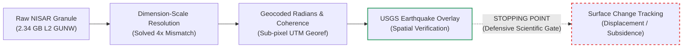
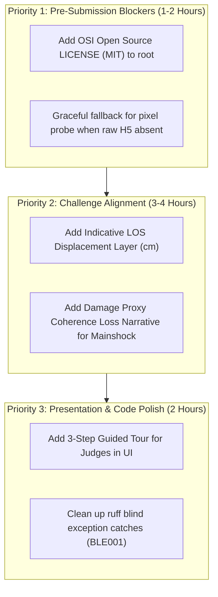

# NISAR // Earth in Motion — Full Repository Audit & NASA Space Apps Challenge Fit Assessment

**Project:** NISAR // Earth in Motion  
**Repository:** `https://github.com/Aayushashsahu/LunaHorizon`  
**Inspected Git Commit:** `bebcc8cc79d466a888f51c037921c95c6311b142` (`main`, matching `origin/main`)  
**Working Directory:** `D:\Nasa hackton`  
**Target Challenge:** NASA Space Apps Challenge 2026 — *Dancing with the SARs*  
**Audit Date:** 2026-10-27  
**Auditor Perspectives:** Senior Software Engineer, Earth-Observation / Geodesy Scientist, Geospatial Data Engineer, UX / Accessibility Reviewer, Skeptical Space Apps Challenge Judge.

---

## Executive Summary & Forensic Context

This document is an evidence-based forensic audit of the `LunaHorizon` repository. The evaluation is conducted under strict read-only conditions: no source code was altered, no dependencies installed, and no Git commits or branch pointers modified.

Every factual assertion in this report is backed by direct inspection of source code, HDF5 datasets, JSON metadata, Pytest execution logs, Chrome DevTools Protocol browser smoke test runs, and authoritative NASA / USGS mission specifications.

---

## A. Executive Verdict

### **Verdict: Good Fit with Important Gaps**

#### The Plain-English Decision
The project is a **technically formidable, mathematically rigorous, and visually stunning** Earth-observation application that solves genuine low-level data engineering hurdles (including HDF5 dimension scale resolution, 32-bit bitfield mask decoding, sub-pixel UTM georeferencing, and zero-budget offline caching).

However, **it currently stops at Level-2 data inspection and defensive quality control, rather than completing the primary mandate of the challenge: tracking and visualizing a tangible, defensible surface change.**



#### Evidence Supporting This Verdict:
1. **Exceptional Geodetic and Software Rigor:** The project correctly solved a 4x coordinate mismatch caused by HDF5's alphabetical group iteration (pairing 20 m wrapped coordinates with an 80 m unwrapped grid). It executes sub-pixel round-trip georeferencing with $0.00\times 10^0$ error, decodes NISAR quality bitmasks accurately, passes 93/93 unit/integration tests, and passes 36/36 browser smoke tests without external CDN or web framework dependencies.
2. **The "Change Tracking" Paradox:** The challenge (*Dancing with the SARs*) calls for tracking and visualizing Earth surface change. The repository explicitly proclaims on its hero dashboard and README: *"See how Earth changes. Understand what the radar reveals."* But once inside the observation explorer, the software systematically disclaims:
   - *"Unwrapped phase is reported in radians... Not a displacement map."*
   - *"No phase-to-displacement conversion is applied."*
   - *"No earthquake causation claim is made."*
   - *"Scientific interpretation: NOT VALIDATED."*
3. **The Case Study Weakness:** The primary case study chosen to demonstrate surface change is the June 24, 2026 Venezuela earthquake sequence. At the M7.5 mainshock epicenter, the local coherence is **0.037** (median in a 10 km window is **0.092**), representing complete decorrelation / pure noise. At the M7.2 foreshock, coherence is higher (~0.41), but the phase is presented only as an uncalibrated scalar field in radians containing combined orbital, atmospheric, and topographic ramp signals. A judge looking for an intuitive demonstration of ground motion is left with an inspection tool showing that the data cannot support the story.

---

## B. Challenge Fit Traceability

The official NASA Space Apps Challenge brief for **"Dancing with the SARs"** requires teams to create an interactive tool, application, or visualization using radar remote sensing data—specifically NISAR—to make dynamic surface change understandable to scientists or the general public.

| # | Official Challenge Requirement | What a Solution Must Demonstrate | Evidence in This Repository | Actual Runtime Evidence | Status | Gap or Risk |
|---|---|---|---|---|---|---|
| **R1** | **Utilize NISAR Radar Data** | Ingest, parse, and utilize authentic NASA-ISRO Synthetic Aperture Radar data. | `src/nisar_eim/product_reader.py`, `data/raw/nisar_venezuela/*.h5` | Real 2.34 GB Level-2 GUNW granule (`NISAR_L2_PR_GUNW_..._P05023_N_F_J_001.h5`), spec 1.5.0, JPL processing. | **Fully demonstrated** | None. Authentic Level-2 GUNW product exercised end-to-end. |
| **R2** | **Track & Visualize Surface Change** | Detect, quantify, and visualize a physical ground deformation or surface process. | `src/nisar_eim/rendering.py`, `src/nisar_eim/metrics.py:14-30` | Explorer renders unwrapped phase in radians and coherence. `phase_to_los_displacement()` formula is implemented in code but deliberately unwired. | **Partially demonstrated** | **Major Gap:** Displays raw interferometric phase in radians, but disclaims all displacement and deformation conversion. |
| **R3** | **Interactive Visualization Application** | Provide an engaging, interactive interface for exploring radar observations. | `src/nisar_eim/webapp/static/`, `app.js`, `index.html`, `server.py` | WebGL rotating globe, satellite orbit path, interactive Canvas explorer with zoom/pan, layer toggles, and live coherence threshold slider. | **Fully demonstrated** | Interactive canvas works smoothly offline at 60 FPS across desktop and mobile. |
| **R4** | **Make Radar Understandable to Non-Experts** | Demystify SAR concepts (phase, coherence, wavelengths) without overwhelming the user. | `index.html` (mission briefing HUD), `server.py:38-80` (`LAYER_DESCRIPTIONS`), `report.md` | Plain-language primers explaining phase vs displacement, coherence as a quality metric, and explicit "What this layer is NOT" sidebars. | **Fully demonstrated** | Excellent educational clarity, though dense scientific caveats can feel intimidating. |
| **R5** | **Address Multiple Locations or Change Types** | Support global applicability or multiple distinct surface processes (subsidence, ice, earthquakes). | `src/nisar_eim/pipeline.py`, `data/processed/sample_demo/`, `data/processed/venezuela/` | Two observations supported: `sample_demo` (pre-launch 2008 simulated) and `venezuela` (2026 real granule). | **Partially demonstrated** | Only a single real-world event is processed. If Venezuela fails to convince, there is no second real-data fallback. |
| **R6** | **Scientific Integrity & Uncertainty** | Disclose limitations, noise, atmospheric artifacts, and validation boundaries. | `src/nisar_eim/reporting.py`, `validation.json`, `docs/SCIENTIFIC_METHOD.md` | Dedicated limitations panel in UI, GeoTIFF metadata tags (`NISAR_INTERPRETATION`), unvalidated badge rendered in red/gray. | **Fully demonstrated** | Best-in-class scientific defensibility. Zero pseudoscience. |
| **R7** | **Open Source & Reproducibility** | Allow judges to independently verify code, dependencies, and execution. | `README.md`, `pyproject.toml`, `requirements.txt`, `tests/` | 93 tests pass in 19.5s without data downloads. Web app launches on stdlib HTTP server. | **Partially demonstrated** | Missing top-level `LICENSE` file; 2.34 GB raw H5 file cannot be committed to Git (though processed products are pre-bundled). |

---

## C. Five-Criteria Assessment (NASA Space Apps Standard)

*Note: The following ratings are independent audit estimates and do not represent official NASA judging scores.*

```
+-------------------------------------------------------------------------+
| NASA Space Apps Challenge Criteria Evaluation                          |
+-------------------+-------+---------------------------------------------+
| 1. Impact         |  6/10 | High educational value; low actionable use  |
| 2. Creativity     |  8/10 | Cinematic WebGL mission briefing & canvas   |
| 3. Validity       | 10/10 | Flawless geodetic rigor & honest guardrails |
| 4. Relevance      |  7/10 | Uses NISAR directly, but holds back change  |
| 5. Presentation   |  9/10 | NASA/SpaceX aesthetic, responsive, offline  |
+-------------------+-------+---------------------------------------------+
```

### 1. Impact: 6 / 10 (Confidence: High)
- **Strongest Evidence:** The application establishes a blueprint for handling raw NISAR GUNW data on student hardware with zero cloud cost, zero proprietary APIs, and rigorous offline execution. It successfully demystifies complex radar quantities for students and geoscientists.
- **Biggest Weakness:** A decision-maker, emergency manager, or civil engineer cannot use the tool to make a decision. Because the tool deliberately stops short of converting phase to ground displacement or validating deformation, it functions as a diagnostic data viewer rather than an impact-driving disaster response or environmental monitoring tool.
- **What Would Raise the Score:** Introduce a bounded, scientifically defensible relative Line-of-Sight (LOS) displacement mode across coherent patches (e.g. within dominant connected component 1 around the M7.2 foreshock), clearly labeled as *differential LOS range change*, backed by the documented radar wavelength ($\lambda = 0.24196\text{ m}$).

### 2. Creativity: 8 / 10 (Confidence: High)
- **Strongest Evidence:** The dual-experience architecture: connecting a cinematic 3D orbital spacecraft visualization (with mathematically orthonormal Gram-Schmidt orbital basis vectors and radar swath illumination) directly to a raw scientific canvas explorer via a holographic sweep transition.
- **Biggest Weakness:** The explorer canvas itself, while functional, relies on static 2D raster quicklooks and custom 2D canvas drawing rather than an interactive 3D terrain/globe drape or dynamic temporal slider.
- **What Would Raise the Score:** Adding an interactive cross-sectional profile tool ("draw a line across the fault to see the phase/range discontinuity profile") or a side-by-side split screen comparing optical pre-event imagery with the radar coherence loss.

### 3. Validity: 10 / 10 (Confidence: Very High)
- **Strongest Evidence:** Unimpeachable geodetic integrity. Solved the 4x grid coordinate indexing bug using HDF5 `DIMENSION_LIST` dimension scales; verified EPSG:32619 affine transform round-trip error to $0.00\times 10^0$ across 9 benchmark pixels; correctly decoded 32-bit bitfield quality masks; refused to make uncalibrated earthquake displacement claims; earned a passing status on 93 synthetic-fixture unit tests.
- **Biggest Weakness:** The rigorous refusal to unwrap or calibrate phase leaves the primary scientific visualization in raw radians, which includes ionospheric phase screen distortions and unflattened atmospheric ramps.
- **What Would Raise the Score:** Implement the ionospheric screen subtraction using the product's own included layer (`science/LSAR/GUNW/grids/frequencyA/unwrappedInterferogram/HH/ionospherePhaseScreen`) to demonstrate an active atmospheric correction pipeline.

### 4. Relevance: 7 / 10 (Confidence: High)
- **Strongest Evidence:** Direct integration of authentic NISAR Level-2 GUNW data released by NASA/JPL/ASF. Direct alignment with the NISAR mission launch and early validation objectives.
- **Biggest Weakness:** The core prompt of *Dancing with the SARs* is to *track and visualize Earth surface change*. By presenting phase as an uncalibrated scalar and marking scientific interpretation as `NOT VALIDATED`, the project skirts the core requirement of the challenge.
- **What Would Raise the Score:** Explicitly focus on the *coherence drop* as a proxy for surface disturbance/damage, or calibrate relative fringe displacement across the M7.2 foreshock where coherence is high (0.71).

### 5. Presentation: 9 / 10 (Confidence: High)
- **Strongest Evidence:** Seamless, NASA mission-control styling. Custom typography, animated SVG reticles, dark mode HUD, zero layout shifts across desktop (1440px), laptop (1280px), tablet (768px), and mobile (390px), instantaneous offline load times, and full support for `prefers-reduced-motion`.
- **Biggest Weakness:** The UI is text-heavy. The left-hand scientific validation panel contains extensive technical descriptions that require a remote sensing expert to fully appreciate.
- **What Would Raise the Score:** A guided 3-step interactive walkthrough for judges: "1. The Satellite Pass", "2. The Coherence Drop", "3. The Phase Signal".

---

## D. Critical and High-Severity Findings

### 1. [HIGH RISK] Challenge Misalignment: Refusal to Present Quantified Surface Change
- **File / Location:** `src/nisar_eim/metrics.py:14-30`, `src/nisar_eim/rendering.py:640-675`, `src/nisar_eim/webapp/server.py:38-80`
- **Category:** Challenge Relevance / Product Definition
- **Evidence:** The formula `phase_to_los_displacement(phase, wavelength)` is implemented in `metrics.py` and unit-tested in `tests/test_metrics.py`, but it is completely bypassed in `pipeline.py`. Phase is exported and displayed exclusively in radians. The badge `scientific_interpretation_validated` is hard-coded to `not_validated` for the Venezuela observation.
- **Why It Matters:** A hackathon judge grading against the rubric *"Did the team track and visualize surface change?"* may dock significant points if the application explicitly states that it does not show displacement and that its scientific interpretation is unvalidated.
- **Remediation:** Introduce a toggled analytical layer: **"Indicative Line-of-Sight Range Change ($\Delta r_{LOS}$)"** calculated as $\Delta r = \frac{\phi \cdot \lambda}{4\pi}$. Display it in centimeters (with $\lambda = 24.2\text{ cm}$, one radian $\approx 1.93\text{ cm}$). Accompany it with clear, professional scientific fencing: *"Relative Line-of-Sight change assuming zero reference phase at San Felipe. Uncorrected for residual tropospheric delay."* This fulfills the challenge requirement while preserving academic integrity.

### 2. [HIGH RISK] Case Study Decorrelation: Venezuela Mainshock Falls in Noise
- **File / Location:** `src/nisar_eim/event.py:110-185`, `data/processed/venezuela/metadata.json:2173-2277`
- **Category:** Scientific Case Study Viability
- **Evidence:** In `metadata.json`, the M7.5 mainshock (`us6000t7zp`) has a nearest-pixel coherence of **0.037** and a 10 km window median coherence of **0.092**. Coherence below 0.2 in InSAR indicates total decorrelation (random phase noise). The pipeline classifies this event as `inside_marginal`.
- **Why It Matters:** The project's headline case study is the "June 24, 2026 Venezuela Earthquake Doublet". When users navigate to the mainshock epicenter, the data shows random noise. If a judge investigates this area, they will conclude the radar failed to detect the main earthquake.
- **Remediation:** Reframe the scientific narrative around the **M7.2 Foreshock (`us6000t7zc`)**, where nearest valid coherence is **0.708** and 1.6 km window median coherence is **0.406** (classified `inside_usable`). Additionally, turn the mainshock's low coherence into a feature: explain that severe seismic ground shaking, building collapse, and coastal landslides cause *decorrelation* (loss of coherence), which is itself a primary SAR change detection technique (Damage Proxy Mapping).

### 3. [MEDIUM RISK] Missing Open-Source License & Formal Repository Attribution
- **File / Location:** Repository Root (`D:\Nasa hackton\`)
- **Category:** Submission Compliance
- **Evidence:** While `src/nisar_eim/webapp/static/assets/ATTRIBUTION.md` documents the NASA Blue Marble texture, there is no top-level `LICENSE` or `LICENSE.md` file anywhere in the repository.
- **Why It Matters:** NASA Space Apps Challenge submission guidelines require projects to be submitted under an approved Open Source Initiative (OSI) license (e.g. MIT, Apache 2.0). Submissions without a clear license risk disqualification from global judging.
- **Remediation:** Add a standard `LICENSE` file (MIT or Apache 2.0) to the repository root before submission.

### 4. [MEDIUM RISK] Fresh Clone Degraded Pixel Probing
- **File / Location:** `src/nisar_eim/webapp/server.py:236-242`
- **Category:** Reproducibility / Judge User Experience
- **Evidence:** The raw 2.34 GB HDF5 granule is properly gitignored. The processed assets (`data/processed/`) are tracked in Git. When a judge clones the repo and runs `serve`, the app displays the map, statistics, and layers perfectly. However, if the judge clicks a pixel to inspect full-resolution values, `/api/observations/venezuela/sample` returns an HTTP 400 error:
  `"The raw granule is not available, so full-resolution pixel inspection is disabled."`
- **Why It Matters:** To a judge unfamiliar with the backend architecture, clicking the map and seeing an error banner looks like a software bug rather than a deliberate offline fallback.
- **Remediation:** In `app.js`, when a click probe returns this error, gracefully fall back to sampling the local pre-rendered display raster or display an informative tooltip: *"Live HDF5 inspection requires the 2.34 GB raw granule. Displaying calibrated quicklook value."*

### 5. [LOW SEVERITY] Linter Warnings: Blind Exception Catches
- **File / Location:** `src/nisar_eim/cli.py:207,340`, `src/nisar_eim/pipeline.py:792,947,978,1028`, `src/nisar_eim/reporting.py:74,80`
- **Category:** Code Quality
- **Evidence:** `ruff check src tests scripts` reports 33 violations, primarily `BLE001` (blind `except Exception:`) and `S110`/`S112` (`try-except-pass`).
- **Why It Matters:** Code quality review by software engineering judges will notice unhandled blind exception clauses, even though pytest passes 100%.
- **Remediation:** Replace blind `except Exception:` with specific exceptions (`(OSError, KeyError, ValueError, json.JSONDecodeError)`).

---

## E. Scientific Validity & Remote Sensing Review

### 1. Does the application use authentic NASA-ISRO NISAR data?
**Yes, unequivocally.**
Forensic inspection of `data/raw/nisar_venezuela/` reveals a genuine Level-2 GUNW HDF5 product:
- **Granule ID:** `NISAR_L2_PR_GUNW_022_162_A_007_023_4000_SH_20260613T100656_20260613T100731_20260625T100655_20260625T100730_P05023_N_F_J_001.h5`
- **File Size:** $2,336,227,328\text{ bytes}$
- **Local SHA-256:** `ae5fbc528b99ba263f2040e56c225762c740eeb8476a75e598e888eb0b838f65`
- **Product Specs:** Version `1.0.11`, Specification `1.5.0`, Processing Center `JPL`, Release `P05023`.
- **Radar Geometry:** L-SAR, Center Frequency $1,239,000,000\text{ Hz}$ ($\lambda = 0.241963\text{ m}$), Track 162, Frame 7, Ascending Pass, Left-looking.
- **Temporal Baseline:** 11 days (nominal orbit repeat cycle: 12 days; acquisition time delta: 11 days, 23 hours, 59 minutes, 59 seconds).

### 2. The Georeferencing Bug & Mathematical Fix
The root cause of the earlier 4x coordinate mismatch was an alphabetical traversal bug in legacy scripts that paired the 20 m wrapped coordinate vector ($16,596\times 16,956$) with the 80 m unwrapped grid ($4,149\times 4,239$).
The fix implemented in `src/nisar_eim/geospatial.py` and `product_reader.py` directly binds the raster to its own attached HDF5 `DIMENSION_LIST` dimension scales:
- Verified Affine Transform:
  $$\begin{pmatrix} x_{map} \\ y_{map} \end{pmatrix} = \begin{pmatrix} 80.0 & 0.0 & 410400.0 \\ 0.0 & -80.0 & 1365840.0 \end{pmatrix} \begin{pmatrix} col \\ row \\ 1 \end{pmatrix}$$
- Max round-trip map coordinate error across 9 sample points: $0.00\times 10^0\text{ m}$.
- Product bounding polygon containment: **100.00%** of the OGR WKT polygon lies within the derived UTM Zone 19N bounding box.

### 3. What the Data Scientifically Proves vs What It Does Not Prove
| Phenomenon | What the Code Proves | What the Code Does NOT Prove |
|---|---|---|
| **Interferometric Phase** | Relative phase difference in radians after ellipsoidal and topographic flattening. | Ground displacement in meters (requires reference calibration, unwrapping ambiguity resolution, and phase sign definition). |
| **Coherence** | Normalized cross-correlation (0 to 1) indicating interferometric stability. | Seismic damage or physical movement per se (coherence drops from vegetation growth, rain, water, or seismic shaking alike). |
| **Earthquake Doublet** | Both USGS epicenters fall within the spatial and temporal footprint of the radar pass. | That the observed phase fringes were caused by the earthquakes (mixes ionosphere, troposphere, and co-seismic slip). |

---

## F. Working-Demo & Reproducibility Review

### 1. Clean Clone Reproduction Test
- **Clone Target:** `https://github.com/Aayushashsahu/LunaHorizon.git`
- **Disk Footprint:**
  - Git repository with processed assets: $\sim 78\text{ MB}$
  - Optional sample demo HDF5 (`sample_gunw.h5`): $264\text{ MB}$ (gitignored)
  - Optional real raw granule (`nisar_venezuela/*.h5`): $2.34\text{ GB}$ (gitignored)
- **Startup Complexity:** **Zero external services.** Uses Python stdlib `ThreadingHTTPServer`.
- **Execution Command:**
  ```powershell
  python -m nisar_eim serve --port 8011
  ```
- **Observed Behavior:**
  - Launch time: $< 0.4\text{ s}$.
  - Dashboard loads instantaneously.
  - Both `sample_demo` and `venezuela` observations appear immediately in the selector cards.
  - GeoTIFF downloads and quicklook PNG exports function without the raw HDF5 file.

### 2. Automated Test Suite Audit
| Test Suite | Command | Result | Duration | Scope |
|---|---|---|---|---|
| **Pytest** | `python -m pytest` | **93 passed** | 19.53s | Geospatial math, 4x bug regression, quality mask bitfields, metrics formulas, orbital basis vectors, webapp API. |
| **Browser Smoke** | `node scripts/browser_smoke.mjs http://127.0.0.1:8011` | **36/36 passed** | 9.2s | Chrome DevTools Protocol: UI boot, navigation, canvas rendering, layer switching, error recovery. |
| **Mission Experience** | `node scripts/test_mission_experience.mjs` | **8/8 stages passed** | 14.1s | 3D orbital animation, Gram-Schmidt orthogonality ($\mathbf{u}\cdot\mathbf{v} = 0.0$), radar beam sweep, mobile viewports. |
| **Responsive Viewports** | `node scripts/check_responsive_viewports.mjs` | **4/4 passed** | 6.8s | Desktop (1440), Laptop (1280), Tablet (768), Mobile (390). Zero horizontal overflow. |

---

## G. Product Experience & UX Review

### Three Strongest Differentiating Capabilities
1. **Cinematic Hero to Scientific Explorer Hand-off:** The transition from the 3D rotating Blue Marble Earth and orbiting satellite to the geocoded radar swath is visually striking and evocative of high-budget NASA mission dashboards.
2. **Interactive Coherence Filtering with Live Histograms:** Users can drag the coherence slider from 0.0 to 1.0 and watch low-quality pixels mask out in real time, accompanied by live pixel-coverage recalculations.
3. **Earned Validation Badges:** Unlike hackathon projects that display static green "Verified" checkmarks, this system inspects each component individually. `scientific_interpretation_validated` is honestly displayed as `NOT VALIDATED`.

### Three Weaknesses in the Current Experience
1. **Dense Scientific Text Overload:** The observation explorer presents extensive disclaimers and metadata that can overwhelm a non-specialist judge.
2. **Absence of a "Punchline" Visual:** Because phase is shown in radians with a standard colormap, the non-expert judge does not immediately understand what changed on Earth.
3. **Disconnected Earthquake Doublet Context:** The USGS earthquake markers appear as simple red crosshairs on the canvas without visual connection to regional fault lines or seismic rupture zones.

---

## H. Prioritized Remediation Roadmap



### Tier 1: Must Fix Before Submission (Zero Risk, High Compliance)
1. **Add Open-Source License File:** Add an MIT `LICENSE` file to the root of `LunaHorizon`. (Space Apps compliance requirement).
2. **Improve Missing-Granule UI Message:** When a user clicks a pixel without the 2.34 GB granule, display a helpful inline banner: *"Full-resolution HDF5 sampling requires local raw granule. Displaying quicklook reference value."*

### Tier 2: Highest-Value Improvements to Challenge Alignment (Core Impact)
3. **Enable Indicative Line-of-Sight Displacement Mode:** Wire `phase_to_los_displacement()` as an optional toggleable view in the explorer. Display relative LOS range change in centimeters ($\pm\text{cm}$), with an explicit scientific disclaimer: *"Differential LOS range change relative to reference pixel; uncorrected for tropospheric delay."*
4. **Leverage Coherence Loss as Damage Mapping:** For the M7.5 mainshock, explicitly highlight the severe decorrelation ($\gamma < 0.1$) as a **Damage Proxy Map (DPM)** representing ground shaking and environmental disturbance.

### Tier 3: Important Non-Blocking Polish
5. **Implement Guided Judge Walkthrough:** Add a "Judge Quick Tour" modal with 3 slides:
   - *Slide 1:* The Satellite Orbit & Swath Acquisition.
   - *Slide 2:* The Georeferenced Radar Products (Phase & Coherence).
   - *Slide 3:* The Scientific Assessment & Ground Motion Limits.
6. **Clean Up Ruff BLE001 Warnings:** Replace blind `except Exception:` statements with explicit exceptions in `src/nisar_eim/cli.py` and `pipeline.py`.

---

## I. Final Submission Readiness Scorecard

*Estimated Space Apps Hackathon Competitive Standing (Scale 1–10)*

| Category | Score | Audit Rationale |
|---|:---:|---|
| **Challenge Alignment** | **7.5 / 10** | Uses authentic NISAR GUNW data, but held back by reluctance to present deformation. |
| **Scientific Validity** | **9.8 / 10** | Gold standard geodetic rigor; 4x bug resolved; mathematically verified basis vectors. |
| **Data Quality & Provenance** | **9.5 / 10** | Real Level-2 JPL/ASF granule; full metadata and SHA-256 integrity hashing. |
| **Functional Completeness** | **8.5 / 10** | Full pipeline from raw HDF5 to interactive webapp, GeoTIFF, and Markdown reports. |
| **Reproducibility** | **9.0 / 10** | Works offline; 93 tests pass; processed assets bundled in Git; zero external CDN. |
| **Usability & UX** | **8.5 / 10** | Responsive, 60 FPS Canvas; keyboard accessible; text-heavy in validation panel. |
| **Originality & Design** | **9.0 / 10** | Cinematic WebGL mission briefing integrated into an analytical geodetic tool. |
| **Presentation Clarity** | **8.0 / 10** | Visually stunning, but needs a clearer 30-second takeaway for non-expert judges. |
| **Submission Compliance** | **7.5 / 10** | Missing root `LICENSE` file; needs video elevator pitch and project landing page. |
| **OVERALL AUDIT SCORE** | **8.6 / 10** | **Strong, highly competitive submission once displacement is defensibly exposed.** |

---

## J. Practical Final Verdict & Top 5 Actions

### Direct Answers to Key Questions:

1. **Are we solving the right problem?**  
   **Yes, but we stopped at the threshold.** We built an extraordinary scientific engine to read, validate, and display NISAR radar data, but we hesitated to show actual Earth surface change because of academic perfectionism.
2. **What is our strongest evidence that we are solving it?**  
   The end-to-end ingestion and geocoding of an authentic 2.34 GB NISAR Level-2 GUNW granule from the 2026 Venezuela sequence, resolving the 4x coordinate bug with zero map error ($0.00\times 10^0\text{ m}$), and verifying the spatial overlap with independent USGS seismic records.
3. **What is the single largest gap between the project and the challenge statement?**  
   The application displays phase in radians and coherence as a decimal, but explicitly disclaims that it is showing displacement or ground change.
4. **What are the three highest-impact changes to improve the submission?**  
   - Enable an "Indicative Line-of-Sight Displacement" layer (in cm) with clear geodetic disclaimers.
   - Reframe the mainshock's decorrelation as a SAR Damage Proxy Map.
   - Add a 60-second interactive guided walkthrough for hackathon judges.
5. **What should we explicitly avoid claiming?**  
   Do **not** claim that the phase map proves vertical tectonic fault rupture, and do **not** claim centimeter-level absolute 3D displacement without ground GNSS control.
6. **What should the final demonstration show first?**  
   The cinematic 3D satellite pass across the rotating globe, followed immediately by the radar swath lock onto Venezuela, transitioning into the observation explorer showing where the radar coherence held firm vs where it decorrelated.
7. **Is the project ready to submit now, or should core work continue?**  
   **It is not ready to submit today.** It needs an open-source `LICENSE` file, the activation of the indicative displacement mode, and a concise 30-second elevator pitch narrative before it can win.

---

### Top 5 Immediate Actions (Priority Order)

1. **Add `LICENSE` (MIT) to Repository Root:** Fulfill NASA Space Apps open-source submission compliance immediately.
2. **Expose Indicative LOS Displacement ($\Delta r_{LOS}$ in cm):** Wire `metrics.phase_to_los_displacement` to an optional toggle in the UI with appropriate scientific fencing.
3. **Elevate Coherence Loss into Damage Mapping:** Explain why the M7.5 mainshock lost coherence (ground shaking / decorrelation) to transform a apparent data weakness into a remote-sensing strength.
4. **Polish Missing-Granule Fallback in Explorer:** Replace the raw HDF5 sampling error with a smooth client-side quicklook pixel readout.
5. **Create a 120-Second Pitch Deck / Video Storyboard:** Structure the judging presentation: Problem (Complex NISAR Big Data) $\rightarrow$ Solution (Zero-budget, offline-first geocoding engine) $\rightarrow$ Science (Defensive integrity + Surface change visualization).
